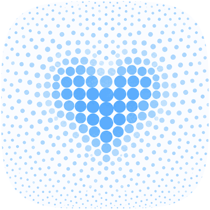

<p align="center">
  
</p>

<h1 align="center">PWN.Health</h1>

<p align="center">
  A private health and fitness tracker for Android that works entirely on the phone:<br>
  no Google Play Services, no account and no network permission.
</p>

<p align="center"><b>English</b> · <a href="README.ru.md">Русский</a> · <a href="README.zh-CN.md">简体中文</a></p>

<p align="center">
  <a href="https://github.com/pwn-all/PWN.Health/actions/workflows/build.yml"></a>
  <a href="https://github.com/pwn-all/PWN.Health/releases/latest"></a>
  
  <a href="#licence"></a>
</p>

<p align="center">
  <a href="#features">Features</a> ·
  <a href="#privacy">Privacy</a> ·
  <a href="#download">Download</a> ·
  <a href="#building-from-source">Building</a> ·
  <a href="#documentation">Documentation</a> ·
  <a href="#licence">Licence</a>
</p>

## About

PWN.Health counts steps, records walks, keeps a journal of food, body, sleep, mood and medicines,
runs workouts and reads lab results — and does all of it on the phone. It is built on Android's own
platform APIs, so it runs on phones without Google Play Services, and it declares no `INTERNET`
permission: nothing you log leaves the device unless you export it, back it up or sync it to Health
Connect yourself.

It is free software under the GPL, free of charge, with no ads and no analytics.

## Features

- **Steps and activity** — reboot-safe step counting from the hardware counter, a motion gate that
  refuses "steps" felt in a car or a bus, and floors climbed from the barometer.
- **Walks and routes** — GPS tracks without Google's location services, drawn over an offline map
  of relief, rivers, forests and towns; export to GPX, GeoJSON or CSV.
- **Food** — a meal journal, offline recognition of dishes and foods from a photo, nutrition labels
  read off a packet, and daily feedback on what was eaten.
- **Body and health journal** — weight, heart rate, blood pressure, sleep, water, mood, cycle, pain
  on a body map, medical history, and evidence-based advice.
- **Medicines** — courses with dose reminders, an adherence chart, appointments and routine
  check-ups.
- **Workouts** — templates, a catalogue of exercises with the muscles they work, live set-by-set
  sessions with rest timers, supersets and RIR / RPE.
- **Lab results** — typed in or read off photographs and PDFs, with reference ranges, charts and a
  PDF report for a doctor.
- **Health chat** — questions about symptoms, answered by rules and an ONNX model that runs on the
  device.
- **Imports** — training history from Hevy, Strong, FitNotes and Lyfta, and health exports from
  Apple Health, Fitbit / Google Takeout, Samsung Health, Garmin, Withings, Oura, Strava, Nike Run
  Club, Flo, MyFitnessPal, Cronometer and Google Fit.
- **Health Connect** — optional two-way sync, written so that nothing is counted twice.
- **Bluetooth** — standard Bluetooth LE health devices, Xiaomi and COLMI devices, the Concept2 PM5
  and a Bangle.js 2 watch running the PWN.Health watch app.
- **Everything else** — home-screen widgets, reminders, levels and achievements, and sixteen
  languages, each translated whole.

The full list, with the state of each part and the file that holds it, is the status table in
[docs/DESIGN.md](docs/DESIGN.md#implementation-status).

## Privacy

- **No network.** The manifest declares no `INTERNET` permission, and `NoNetworkPermissionTest`
  fails the build if one ever appears. The ONNX Runtime the app ships is built without Microsoft's
  telemetry ([tools/onnxruntime-android](tools/onnxruntime-android/README.md)).
- **No Google Play Services**, no account, no ads, no analytics.
- **Your data stays yours.** An optional encrypted database (SQLCipher) and app lock; backups as a
  file sealed under a password, or a daily copy into a folder you choose. What each protection does
  and does not stop is in [docs/SECURITY_MODEL.md](docs/SECURITY_MODEL.md), and the app's privacy
  policy is [docs/privacy-policy.html](docs/privacy-policy.html).

## Download

Signed APKs are on the [Releases](https://github.com/pwn-all/PWN.Health/releases) page:

| File | For |
|---|---|
| `app-sideload-arm64-v8a-release.apk` | 64-bit ARM phones — nearly every phone that runs Android 13 |
| `app-sideload-armeabi-v7a-release.apk` | 32-bit ARM phones |

Android 13 or newer is required; there is no x86 build. Every release is signed with the same key,
whose certificate has the SHA-256 fingerprint

```
96:95:4A:82:2B:8A:96:C3:E2:4B:2D:81:17:90:E5:E9:87:6D:C5:C8:F0:8F:BD:87:8A:31:C7:3A:C8:BB:7D:63
```

(`apksigner verify --print-certs <apk>` shows it). An APK signed with any other key is not ours, and
cannot update an installed copy. What changed in each version is in [CHANGELOG.md](CHANGELOG.md).

## Building from source

You need JDK 21 and an Android SDK with `platforms;android-37.1` and `build-tools;37.0.0`, found
through `ANDROID_HOME` or `sdk.dir` in `local.properties`. Everything else — Gradle, the libraries,
ONNX Runtime, the models and the map — comes with the repository or through the wrapper.

```sh
git clone https://github.com/pwn-all/PWN.Health.git
cd PWN.Health
./gradlew assembleSideloadDebug   # installable debug APKs, one per ABI
./gradlew check                   # Android Lint, detekt, ktlint and the unit tests
```

Release builds, dependency verification, signing and how a release is published are in
[docs/BUILDING.md](docs/BUILDING.md).

## Documentation

| Document | What it is |
|---|---|
| [docs/DESIGN.md](docs/DESIGN.md) | How the app works: the status table, step counting, Health Connect, location, storage, the motion gate, the map, food recognition |
| [docs/BUILDING.md](docs/BUILDING.md) | Toolchain, dependency verification, release builds, signing and releases |
| [docs/MODELS.md](docs/MODELS.md) | The networks that ship in the app, by their bytes and SHA-256 |
| [docs/SECURITY_MODEL.md](docs/SECURITY_MODEL.md) | What the app lock, database encryption and sealed backups protect against |
| [CHANGELOG.md](CHANGELOG.md) | What changed in each version, and why |
| [docs/README.md](docs/README.md) | Every document in the repository, and how far to trust it |

## Licence

PWN.Health is free software: the code in this repository is licensed under the GNU General Public
License, version 3 or (at your option) any later version — `GPL-3.0-or-later`. The full text is in
[LICENSE](LICENSE). The app is free of charge and comes with no warranty. In the app, About names
the licence and links to this repository, and "Licence texts" shows every licence in full.

What the app ships besides its own code keeps its own licence:

| Component | Licence |
|---|---|
| ONNX Runtime (built from source by `tools/onnxruntime-android/build.sh`) | MIT |
| SQLCipher | BSD-3-Clause |
| AndroidX, Kotlin, Jetpack Compose, Guava | Apache-2.0 |
| PaddleOCR PP-OCR models | Apache-2.0 |
| Chat reader: Microsoft Multilingual-MiniLM, XLM-R tokenizer | MIT |
| Map: Natural Earth, ETOPO 2022 | Public domain |
| Map: GeoNames, ESA WorldCover | CC BY 4.0 |
| Food table: USDA FoodData Central | CC0 |
| Lab units: UCUM | UCUM licence |
| Places of care: official registers and open data | As named in `Facilities.kt` |
| Food photo model: PE-Core-S16 | Apache-2.0; trained on public food photo datasets under their own terms |
