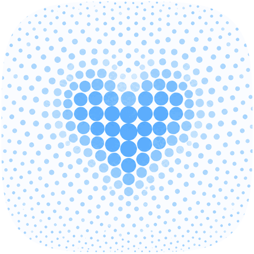

<p align="center">
  
</p>

<h1 align="center">PWN.Health</h1>

<p align="center">
  Приватный трекер здоровья и фитнеса для Android, который целиком работает на телефоне:<br>
  без сервисов Google Play, без аккаунта и без разрешения на доступ к сети.
</p>

<p align="center"><a href="README.md">English</a> · <b>Русский</b> · <a href="README.zh-CN.md">简体中文</a></p>

<p align="center">
  <a href="https://github.com/pwn-all/PWN.Health/actions/workflows/build.yml"></a>
  <a href="https://github.com/pwn-all/PWN.Health/releases/latest"></a>
  
  <a href="#лицензия"></a>
</p>

<p align="center">
  <a href="#возможности">Возможности</a> ·
  <a href="#конфиденциальность">Конфиденциальность</a> ·
  <a href="#загрузка">Загрузка</a> ·
  <a href="#сборка-из-исходного-кода">Сборка</a> ·
  <a href="#документация">Документация</a> ·
  <a href="#лицензия">Лицензия</a>
</p>

## О приложении

PWN.Health считает шаги, записывает прогулки, ведёт дневник питания, тела, сна, настроения и лекарств,
проводит тренировки и читает результаты анализов — и всё это прямо на телефоне. Приложение построено на
собственных API платформы Android, поэтому работает и на телефонах без сервисов Google Play. Разрешения
`INTERNET` в нём нет: ничего из того, что вы записываете, не покидает устройство, пока вы сами не
экспортируете данные, не сделаете резервную копию или не синхронизируете их с Health Connect.

Это свободная программа под лицензией GPL: бесплатная, без рекламы и без аналитики.

## Возможности

- **Шаги и активность** — подсчёт шагов по аппаратному счётчику, который не сбивается при перезагрузке;
  фильтр движения, который не засчитывает «шаги», набранные в машине или автобусе; этажи по данным
  барометра.
- **Прогулки и маршруты** — GPS-треки без служб геолокации Google поверх офлайн-карты с рельефом,
  реками, лесами и городами; экспорт в GPX, GeoJSON и CSV.
- **Еда** — дневник приёмов пищи, офлайн-распознавание блюд и продуктов по фотографии, чтение
  этикетки с пищевой ценностью прямо с упаковки и ежедневные подсказки о том, что было съедено.
- **Тело и дневник здоровья** — вес, пульс, артериальное давление, сон, вода, настроение, цикл, боль,
  отмеченная на фигуре тела, история болезни и советы, основанные на доказательной медицине.
- **Лекарства** — курсы с напоминаниями о приёме, график приверженности, записи к врачу и плановые
  осмотры.
- **Тренировки** — шаблоны, каталог упражнений с указанием работающих мышц, тренировка в реальном
  времени подход за подходом с таймером отдыха, суперсетами и RIR / RPE.
- **Анализы** — вводятся вручную или считываются с фотографий и PDF; референсные диапазоны, графики и
  отчёт для врача в PDF.
- **Разговор о самочувствии** — ответы на вопросы о симптомах по правилам и с помощью модели ONNX,
  которая работает на самом устройстве.
- **Импорт** — история тренировок из Hevy, Strong, FitNotes и Lyfta и выгрузки данных о здоровье из
  Apple Health, Fitbit / Google Takeout, Samsung Health, Garmin, Withings, Oura, Strava, Nike Run
  Club, Flo, MyFitnessPal, Cronometer и Google Fit.
- **Health Connect** — необязательная двусторонняя синхронизация, устроенная так, что ничего не
  учитывается дважды.
- **Bluetooth** — стандартные медицинские устройства Bluetooth LE, устройства Xiaomi и COLMI,
  Concept2 PM5 и часы Bangle.js 2 с приложением PWN.Health для часов.
- **И всё остальное** — виджеты на главном экране, напоминания, уровни и медали и шестнадцать языков,
  каждый из которых переведён полностью.

Полный список — с состоянием каждой части и файлом, в котором она находится, — приведён в таблице
состояния в [docs/DESIGN.md](docs/DESIGN.md#implementation-status).

## Конфиденциальность

- **Никакой сети.** Манифест не объявляет разрешения `INTERNET`, а `NoNetworkPermissionTest`
  проваливает сборку, если оно когда-нибудь появится. ONNX Runtime, входящий в приложение, собран без
  телеметрии Microsoft ([tools/onnxruntime-android](tools/onnxruntime-android/README.md)).
- **Без сервисов Google Play**, без аккаунта, без рекламы, без аналитики.
- **Ваши данные остаются вашими.** Необязательное шифрование базы данных (SQLCipher) и блокировка
  приложения; резервные копии — в виде файла, защищённого паролем, или автоматической ежедневной копии
  в папку, которую вы выберете. От чего защищает каждая из этих мер и от чего не защищает, описано в
  [docs/SECURITY_MODEL.md](docs/SECURITY_MODEL.md), а политика конфиденциальности приложения —
  [docs/privacy-policy.html](docs/privacy-policy.html).

## Загрузка

Подписанные APK выложены на странице [Releases](https://github.com/pwn-all/PWN.Health/releases):

| Файл | Для чего |
|---|---|
| `app-sideload-arm64-v8a-release.apk` | Телефоны на 64-битном ARM — почти любой телефон с Android 13 |
| `app-sideload-armeabi-v7a-release.apk` | Телефоны на 32-битном ARM |

Нужен Android 13 или новее; сборки для x86 нет. Все выпуски подписаны одним и тем же ключом; отпечаток
SHA-256 его сертификата:

```
96:95:4A:82:2B:8A:96:C3:E2:4B:2D:81:17:90:E5:E9:87:6D:C5:C8:F0:8F:BD:87:8A:31:C7:3A:C8:BB:7D:63
```

(его показывает `apksigner verify --print-certs <apk>`). APK, подписанный любым другим ключом, — не
наш, и установленную копию он обновить не сможет. Что изменилось в каждой версии, смотрите в
[CHANGELOG.md](CHANGELOG.md).

## Сборка из исходного кода

Понадобятся JDK 21 и Android SDK с `platforms;android-37.1` и `build-tools;37.0.0`, путь к которому
задаётся через `ANDROID_HOME` или `sdk.dir` в `local.properties`. Всё остальное — Gradle, библиотеки,
ONNX Runtime, модели и карта — уже есть в репозитории или загружается через Gradle Wrapper.

```sh
git clone https://github.com/pwn-all/PWN.Health.git
cd PWN.Health
./gradlew assembleSideloadDebug   # installable debug APKs, one per ABI
./gradlew check                   # Android Lint, detekt, ktlint and the unit tests
```

Первая команда собирает отладочные APK для установки, по одному на каждый ABI; вторая запускает Android
Lint, detekt, ktlint и модульные тесты. Сборка выпусков, проверка зависимостей, подпись и публикация
выпуска описаны в [docs/BUILDING.md](docs/BUILDING.md).

## Документация

| Документ (на английском) | Что в нём |
|---|---|
| [docs/DESIGN.md](docs/DESIGN.md) | Как устроено приложение: таблица состояния, подсчёт шагов, Health Connect, геолокация, хранение данных, фильтр движения, карта, распознавание еды |
| [docs/BUILDING.md](docs/BUILDING.md) | Инструменты сборки, проверка зависимостей, сборка выпусков, подпись и выпуски |
| [docs/MODELS.md](docs/MODELS.md) | Нейросети, которые входят в приложение, — с размером в байтах и SHA-256 |
| [docs/SECURITY_MODEL.md](docs/SECURITY_MODEL.md) | От чего защищают блокировка приложения, шифрование базы данных и резервные копии под паролем |
| [CHANGELOG.md](CHANGELOG.md) | Что изменилось в каждой версии и почему |
| [docs/README.md](docs/README.md) | Все документы репозитория и то, насколько каждому из них можно доверять |

## Лицензия

PWN.Health — свободная программа: код в этом репозитории распространяется на условиях GNU General
Public License версии 3 или (по вашему выбору) любой более поздней версии — `GPL-3.0-or-later`. Полный
текст лицензии находится в файле [LICENSE](LICENSE). Приложение бесплатно и поставляется без каких-либо
гарантий. В самом приложении на странице «О приложении» указана лицензия и есть ссылка на этот
репозиторий, а в разделе «Тексты лицензий» каждая лицензия приведена целиком.

Всё, что входит в приложение помимо его собственного кода, сохраняет свою лицензию:

| Компонент | Лицензия |
|---|---|
| ONNX Runtime (собирается из исходного кода скриптом `tools/onnxruntime-android/build.sh`) | MIT |
| SQLCipher | BSD-3-Clause |
| AndroidX, Kotlin, Jetpack Compose, Guava | Apache-2.0 |
| Модели PaddleOCR PP-OCR | Apache-2.0 |
| Читатель чата: Microsoft Multilingual-MiniLM, токенизатор XLM-R | MIT |
| Карта: Natural Earth, ETOPO 2022 | Public domain (общественное достояние) |
| Карта: GeoNames, ESA WorldCover | CC BY 4.0 |
| Таблица продуктов: USDA FoodData Central | CC0 |
| Единицы измерения в анализах: UCUM | UCUM licence |
| Клиники и больницы: официальные реестры и открытые данные | Указаны в `Facilities.kt` |
| Модель для фотографий еды: PE-Core-S16 | Apache-2.0; обучена на открытых наборах фотографий еды, у каждого из которых свои условия |

Этот раздел — перевод. Имеющим силу считается раздел [Licence](README.md#licence) английского README.
